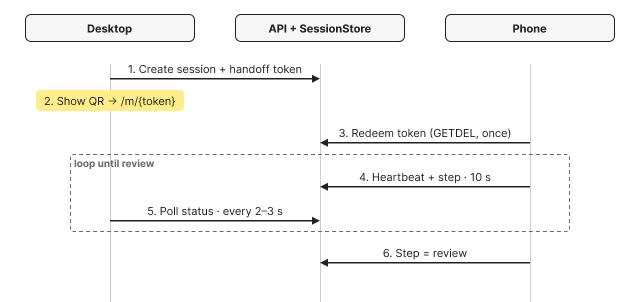

# Architecture — Digital KYC Journey

*Two-page summary, as the brief requires. Detail lives in `specs/`; screens in `docs/wireframes.pdf`.*

## 1. Application structure

- **One Next.js app** serves both the UI and the mock API. Route handlers sit behind a `SessionStore` interface, so the same code runs on a laptop (in memory) and on Vercel (Redis).
- **Copy is data, not code:** every user-facing string, including aria text, comes from a bundled JSON file through a `ContentSource` interface. A CMS with the same shape can replace it later without component changes.
- **Mocks are honest about their shape:** realistic latency, per-check results and forceable failures, so the UI is built against behaviour, not happy-path stubs.

## 2. State management

There are three kinds of state, deliberately kept apart:

| Kind | Owner | Example |
|---|---|---|
| **Journey state** (where am I, what's allowed next) | XState machine | `documentValidation`, `docAttempts`, `cameraError` |
| **Server state** (what the server knows) | React Query | session status, upload mutations |
| **Shared cross-device truth** | Server (`SessionStore`) | `session.step`, `lastSeen`, check results |

The machine uses the brief's states plus `qrHandoff`. Events drive every transition, and guards enforce retry limits (3 document attempts, 3 face-match attempts). Camera, upload, offline and timeout problems are **context flags inside states**, not extra states. That keeps the chart readable and avoids duplicating error states per capture step.

API calls live outside the machine: components call React Query and `send()` the result as an event, so the machine stays synchronous and testable without network mocks. The UI shows **4 user-facing steps** over 12 machine states, the same on every path.

One subscriber on the machine records every transition to an **audit trail** and emits **funnel events** (step viewed / failed / retried, with reason codes and no personal data). They serve compliance (BR-1) and BI (BR-6) without touching state logic.

## 3. QR / device handoff design

**Principle: the server is the single source of truth.** On Vercel, the desktop's and phone's requests can hit different instances that share no memory, so both devices read and write one Redis-backed session. Each device's machine follows the server; if the devices disagree, the server wins.

1. **Create:** `POST /api/session` writes `session:{id}` (15-min sliding TTL) and `handoff:{token}` (10-min TTL, ≥128-bit random). The desktop gets the session ID in an httpOnly cookie.
2. **Show QR:** the code encodes `https://<request host>/m/{token}`. The host comes from `x-forwarded-host`, so localhost tunnels, Vercel previews and production all work without configuration.
3. **Redeem:** the phone calls `POST /api/handoff/{token}`. Redis `GETDEL` reads and deletes the token atomically, so it works exactly once. The phone gets its own cookie and is redirected to a clean `/m`.
4. **Progress:** the phone writes each step to the session and sends a heartbeat every 10 s.
5. **Sync:** the desktop polls status every 2–3 s (paused when hidden) and sends matching events into its machine. `lastSeen > 30 s` → "Phone disconnected"; an expired token → "Code expired" with a one-click refresh that keeps the session.
6. **Handback:** the phone marks `review`; the desktop's next poll moves to Review.

**Why polling:** Vercel functions can't hold WebSockets, and SSE runs into function time limits. A 2–3 s poll is robust and fast enough for a human-paced flow. A hosted realtime service is the production upgrade.

**Proving it:** all session state goes through `SessionStore`, never module memory, and the full handoff is run on a Vercel preview (the real multi-instance environment) with a real phone. Environments are listed in the README.

## 4. Security considerations

| Risk | Mitigation |
|---|---|
| QR leaked or photographed | Token only (no session ID), 10-min TTL, single use (`GETDEL`), revoked on refresh and on completion |
| Session hijack, cross-site requests | Session ID only in httpOnly, `SameSite=Lax` cookies; token removed from the URL after redemption; `POST`s rejected unless `Origin` matches the host |
| Shared/abandoned device | 15-min idle expiry, with a warning dialog; expiry discards captures on the server |
| Personal data | Images resized on the device; full-size images never stored; ~320 px thumbnails expire with the session; logs hold session IDs and step names only |
| Leaking fraud signals | Final rejection shows a support reference, never which check failed |
| Public demo misuse | "Don't use a real ID" banner, `noindex`, no retention, in line with POPIA's minimisation principle |
| Oversized/abusive uploads | Client resize + ~4.5 MB server limit; retries capped |

**Required before production** (designed, not built; see the production backlog in `specs/PLAN.md`): a real verification provider, signed tokens, rate limiting, device binding, encryption at rest with a retention policy, and error tracking with alerts.
