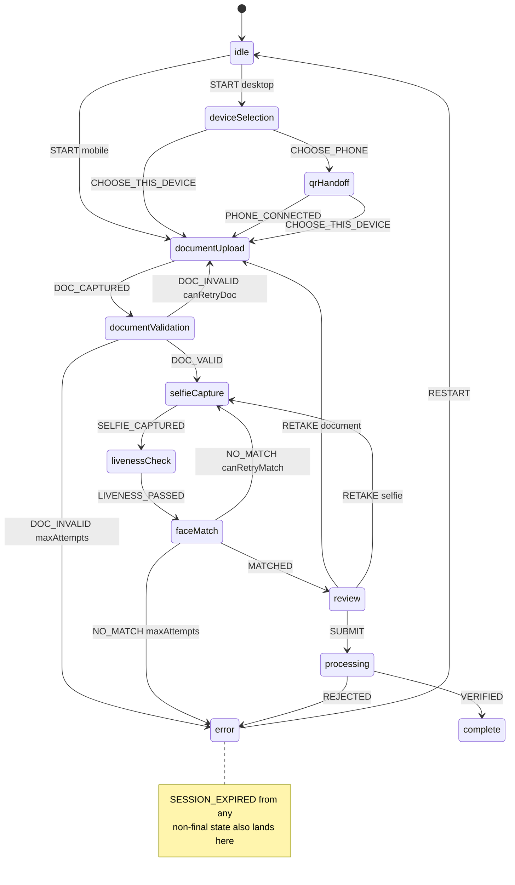

# 01 · Journey state machine

**Covers:** the brief's State Management section. It's the backbone every other spec plugs into.
**Serves:** BR-1, BR-4 (only valid paths through verification; retry limits cap fraud attempts).
**Screens:** all (see the flow map in `docs/wireframes.pdf`).

## Context

The brief asks for the KYC journey to be modelled as a workflow with well-defined states. A single XState machine is the only place transitions are defined, so impossible combinations (e.g. "uploading and in review") can't happen.

## Requirements

- R-01.1 States: `idle`, `deviceSelection`, `qrHandoff`, `documentUpload`, `documentValidation`, `selfieCapture`, `livenessCheck`, `faceMatch`, `review`, `processing`, `complete`, `error`. `qrHandoff` is added to the brief's list for the desktop → phone switch.
- R-01.2 Events (happy path): `START`, `CHOOSE_PHONE`, `CHOOSE_THIS_DEVICE`, `PHONE_CONNECTED`, `DOC_CAPTURED`, `DOC_VALID`, `SELFIE_CAPTURED`, `LIVENESS_PASSED`, `MATCHED`, `SUBMIT`, `VERIFIED`.
- R-01.3 Events (failure & control): `DOC_INVALID`, `UPLOAD_FAILED`, `NO_MATCH`, `RETAKE`, `REJECTED`, `SESSION_EXPIRED`, `REFRESH_TOKEN`, `RESTART`.
- R-01.4 Context: `documentType`, `docAttempts`, `matchAttempts`, `device` (`desktop` | `phone`), flags `cameraError`, `uploadError`, `offline`, `timeoutWarning`.
- R-01.5 Camera, upload, offline and timeout problems are **context flags inside states**, not separate states.
- R-01.6 On mobile, `START` goes straight to `documentUpload` (device selection and QR handoff are skipped).
- R-01.7 Progress counts **verification steps only**, from one ordered list `progressSteps`, so every path shows the same numbers. `idle`, `deviceSelection` and `qrHandoff` are setup and show no counter; `processing`, `complete` and `error` show none either.

  | # | Step (`progress.steps.*`) | Machine states |
  |---|---|---|
  | 1 | `document` | `documentUpload`, `documentValidation` |
  | 2 | `selfie` | `selfieCapture` |
  | 3 | `liveness` | `livenessCheck`, `faceMatch` |
  | 4 | `review` | `review` |

  `{current}` and `{total}` are derived from this list, never hard-coded per screen. On desktop while the phone captures (D4), `{current}` comes from the server's `session.step` (spec 02).

## Acceptance criteria

- **AC-01.1** GIVEN `idle` WHEN `START` on desktop THEN state is `deviceSelection`; on mobile THEN `documentUpload`.
- **AC-01.2** GIVEN `deviceSelection` WHEN `CHOOSE_THIS_DEVICE` THEN state is `documentUpload` (QR skipped).
- **AC-01.10** GIVEN `qrHandoff` WHEN `CHOOSE_THIS_DEVICE` THEN state is `documentUpload`.
- **AC-01.3** GIVEN `documentValidation` and `docAttempts < 2` WHEN `DOC_INVALID` THEN state is `documentUpload` AND `docAttempts` increments.
- **AC-01.4** GIVEN `documentValidation` and `docAttempts = 2` WHEN `DOC_INVALID` (the third failed attempt) THEN state is `error` with reason `maxAttempts`, shown as the manual-review screen E9 (spec 08).
- **AC-01.5** GIVEN `faceMatch` WHEN `NO_MATCH` THEN the same rule applies to `matchAttempts`: back to `selfieCapture` after the first and second failures, `error` with `maxAttempts` (E9) on the third.
- **AC-01.6** GIVEN any non-final state WHEN `SESSION_EXPIRED` THEN state is `error` with reason `sessionExpired`. GIVEN `error` WHEN `RESTART` THEN state is `idle` with context reset.
- **AC-01.7** GIVEN `review` WHEN `RETAKE` with a target step THEN the machine returns to that step and keeps all other captured data.
- **AC-01.8** Events not defined for the current state are ignored (no transition, no error).
- **AC-01.9** GIVEN any of the three paths (desktop only, desktop → phone, mobile only) WHEN the user reaches `documentUpload` THEN the counter reads "Step 1 of 4"; GIVEN `deviceSelection` or `qrHandoff` THEN no counter is shown; GIVEN D4 THEN its counter equals the phone's.
- **AC-01.11** GIVEN a desktop tab that has finished or abandoned a journey WHEN a new session is created (`START` after `RESTART`, or a fresh `POST /api/session`) THEN the machine context is reset: no document type, attempts, captures or check results carry over from the earlier session.

## Design notes

- `setup({ types, guards, actions }).createMachine(...)` (XState v5) with typed events.
- Guards: `canRetryDoc`, `canRetryMatch`. Actions: `assign` for counters and flags.
- `docAttempts` / `matchAttempts` count **failed** attempts, starting at 0. One constant, `MAX_ATTEMPTS = 3`; a retry is allowed while `attempts + 1 < MAX_ATTEMPTS`, so the third failure ends in manual review.
- Every transition is appended to the session's audit trail and emits funnel events (spec 08), via one `actor.subscribe` hook rather than per-state code.
- API calls stay **outside** the machine (React Query); components `send()` events with the results. This keeps the XState surface small and testable without network mocks.
- The desktop machine **mirrors server status**: when a status poll reports progress, it sends the matching event (see spec 02).
- `production` The current step is reflected in the URL (`?step=`) for refresh and back-button behaviour (PB-10).

## Tasks

- [x] T-01.1 Event and context types → AC-01.8 · verify: `pnpm typecheck` · files: `src/machines/kycMachine.types.ts`
- [x] T-01.3 **Tests first:** a failing test per transition and guard → AC-01.1 – AC-01.8 · verify: `pnpm test src/machines` fails for the right reason · files: `src/machines/kycMachine.test.ts` · gate: tests reviewed
- [x] T-01.2 Machine with states, transitions, guards and actions → AC-01.1 – AC-01.7 · verify: T-01.3 passes · files: `src/machines/kycMachine.ts`
- [x] T-01.4 `progressSteps` and the state → step mapping → R-01.7, AC-01.9 · verify: `pnpm test src/machines` · files: `src/machines/progress.ts`, `src/machines/progress.test.ts`
- [x] T-01.5 `useKycMachine` hook exposing `state`, `send` and `stepNumber` (1–4) → AC-01.1, AC-01.9 · verify: `pnpm test src/machines` · files: `src/machines/useKycMachine.ts`, `src/machines/useKycMachine.test.tsx`
- [x] T-01.6 Check the machine in the Stately visualiser against the flow map → all · verify: manual; screenshot in the PR · files: none
- [ ] T-01.7 `production` Model-based paths with `createTestModel` (PB-4) → AC-01.1 – AC-01.9 · verify: `pnpm test src/machines` · files: `src/machines/kycMachine.paths.test.ts`
- [x] T-01.8 `CHOOSE_THIS_DEVICE` from `qrHandoff` goes to `documentUpload` → AC-01.10 · verify: `pnpm test src/machines` · files: `src/machines/kycMachine.ts`, `src/machines/kycMachine.test.ts` · gate: tests reviewed
- [x] T-01.9 (P6) **Tests first:** a new session starts with a clean context, so no check result from an earlier run in the same tab is shown (E2E F-2) → AC-01.11 · verify: `pnpm test src/machines` · files: `src/machines/kycMachine.ts`, `src/machines/kycMachine.test.ts`, `src/machines/useKycMachine.ts` · gate: tests reviewed
