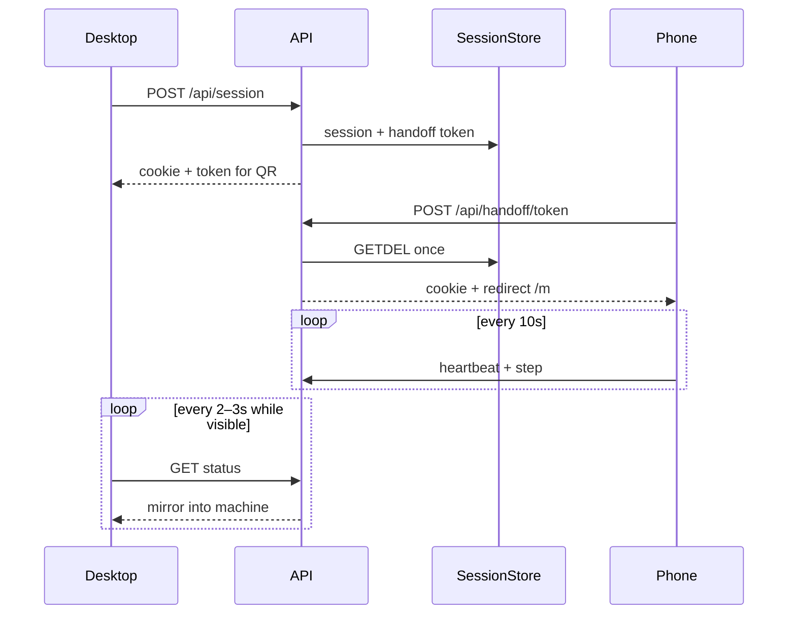

# 02 · Start, session & QR handoff

**Covers:** brief requirements 1 (start screen), 2 (device selection), 3 (QR handoff); API: session creation and status.
**Serves:** BR-2, BR-3, BR-4 (smooth handoff; better phone photos mean fewer failures).
**Screens:** D1, D2, D3, D3b, E8; the header's Help and Save & exit; `/privacy`.

## Context

Users may start on desktop and switch to their phone to capture documents and a selfie. The two devices must share one session even though, on Vercel, their requests can land on different serverless instances. The server (Redis) is the single source of truth.

## Requirements

- R-02.1 The start screen shows the time estimate (3–5 minutes), what's needed, a privacy line and "Start verification".
- R-02.2 Device selection offers "Use my phone" (pre-selected on desktop) and "Continue on this computer". It's skipped on mobile.
- R-02.3 `POST /api/session` creates `session:{id}` (15-min sliding TTL) and `handoff:{token}` (10-min TTL, ≥128-bit random). The session ID goes in an httpOnly cookie and nowhere else: it's never in a response body, a URL or the client's JavaScript. Every other `/api/session/*` call finds the session from that cookie, and returns 401 without one.
- R-02.4 The QR code encodes `https://<host>/m/{token}`, with the host from `x-forwarded-host` → `host`. It contains no session ID.
- R-02.5 `POST /api/handoff/{token}` redeems the token with `GETDEL` (single use), sets the phone's cookie and redirects to `/m`.
- R-02.6 The desktop polls `GET /api/session/status` every 2–3 s (paused while the tab is hidden) and mirrors the server step into its machine. D4's step counter is taken from that same `session.step`, so desktop and phone always show the same number (R-01.7).
- R-02.7 The phone sends `POST /api/session/heartbeat` every 10 s. The desktop treats `lastSeen > 30 s` as disconnected.
- R-02.8 `POST /api/session/handoff` issues a new token and revokes the old one, without restarting the session.
- R-02.9 **Help** (header, every screen, desktop and phone) opens one responsive dialog. It holds three short answers (why we need this, which documents are accepted, what happens to my photos), a link to the privacy notice and a support contact line. It doesn't change the journey state.
- R-02.10 **Save & exit** (desktop header) asks for confirmation, then shows a "saved" page saying the session is kept for its normal 15-minute idle window. It doesn't promise more, because the demo has no account. "Return to Tsogo" is a stub link in the demo.
- R-02.11 **Privacy notice** at `/privacy`, linked from D1 and from Help: what's collected, that full-size images are never stored, that everything expires with the session, that it's a demo, and POPIA in plain language.
- R-02.12 All three use copy from `help.*`, `saveExit.*` and `privacy.*` (spec 09). They have no wireframe yet; Help and the confirmation follow the E5 dialog pattern.
- R-02.13 Session cookies are `httpOnly`, `SameSite=Lax`, `Path=/`, host-only (no `Domain`), and `Secure` over HTTPS. Every `POST` under `/api` checks that `Origin` matches the request host (from the same helper as R-02.4) and returns 403 otherwise, with no state change.
- R-02.14 `production` On the phone, Help opens as a bottom sheet instead of a dialog (PB-6).
- R-02.15 `production` Returning to the same browser within the idle window after Save & exit resumes the journey at the same step (PB-5).

## Acceptance criteria

- **AC-02.1** GIVEN a new visitor WHEN D1 loads THEN they see the time estimate, the requirements list (as a `<ul>`), the privacy line and "Start verification", AND focus is on the `h1`.
- **AC-02.2** GIVEN desktop WHEN D2 loads THEN "Use my phone" is selected AND the options are a radio group usable with arrow keys.
- **AC-02.3** GIVEN D3 WHEN the QR is rendered THEN its URL contains the handoff token and no session ID, AND the host matches the address the desktop is using.
- **AC-02.4** GIVEN a valid token WHEN the phone opens the link THEN the phone joins the session, the URL becomes `/m`, AND within one poll the desktop chip reads "Phone connected" (announced via `aria-live`).
- **AC-02.5** GIVEN a token that has been redeemed WHEN it's opened again THEN it's rejected with a friendly "This link has already been used" page.
- **AC-02.6** GIVEN D3 WHEN the token expires before redemption THEN D3b shows; "Get a new code" shows a fresh QR, AND the session and step are unchanged.
- **AC-02.7** GIVEN the phone is connected WHEN no heartbeat arrives for 30 s THEN D4 switches to the E8 state with "Show the QR code again"; WHEN heartbeats resume THEN it returns to normal.
- **AC-02.8** `production` GIVEN the Docker `prodlike` profile (2 instances) WHEN the full handoff is run THEN it succeeds (proves no in-memory dependency).
- **AC-02.9** GIVEN any screen WHEN "Help" is activated THEN the panel opens with focus on its heading, traps focus, closes with Esc or "Close", returns focus to "Help", AND the journey state is unchanged.
- **AC-02.10** GIVEN desktop WHEN "Save & exit" is confirmed THEN the saved page says how long progress is kept.
- **AC-02.11** GIVEN the "Save & exit" confirmation WHEN "Keep going" or Esc is chosen THEN nothing changes and focus returns to the trigger.
- **AC-02.12** GIVEN D1 or the Help panel WHEN the privacy link is followed THEN `/privacy` opens with every section from R-02.11, AND the journey can be resumed from it.
- **AC-02.13** GIVEN any `POST` to `/api` WHEN its `Origin` doesn't match the request host THEN it returns 403 AND the session is unchanged; GIVEN the session cookie THEN it carries `HttpOnly`, `SameSite=Lax` and, over HTTPS, `Secure`.
- **AC-02.14** GIVEN any `/api/session/*` call without a valid session cookie THEN it returns 401; AND no API response body or URL contains the session ID.
- **AC-02.15** `production` GIVEN a saved session WHEN the user returns in the same browser within 15 minutes THEN the journey resumes at the same step; after that THEN E6 shows.

## API

| Method | Endpoint | Response |
|---|---|---|
| `POST` | `/api/session` | `{ handoffToken, handoffExpiresAt }` + cookie |
| `GET` | `/api/session/status` | `{ step, phoneConnected, lastSeen, checks, handoffExpired }` |
| `POST` | `/api/session/handoff` | `{ handoffToken, handoffExpiresAt }` |
| `POST` | `/api/handoff/:token` | redirect to `/m` + cookie, or 410 if used/expired |
| `POST` | `/api/session/heartbeat` | `204` |

## Design notes

- `SessionStore` interface: `get`, `set(ttl)`, `getDel`, `expire`. Memory adapter on `globalThis` (survives hot reload); Redis adapter via `@upstash/redis`. Keys are prefixed by environment.
- Cookie flags per R-02.13; `Secure` is set from the request protocol, so plain-HTTP localhost still works. `SameSite=Lax` doesn't affect the QR flow: the phone has no cookie until it redeems the token with a same-origin `POST`, which passes the `Origin` check.
- `qrcode.react` SVG with an accessible name ("QR code to continue on your phone") plus a text fallback ("Can't scan? Continue on this computer").
- Polling via `useQuery({ refetchInterval: 2500, refetchIntervalInBackground: false })`.

## Tasks

- [ ] `SessionStore` interface + memory + Redis adapters, with tests
- [ ] Route handlers: sessions, status, handoff (issue + redeem), heartbeat
- [ ] Request-host helper (`x-forwarded-host` / `x-forwarded-proto`)
- [ ] D1, D2, D3, D3b components
- [ ] Phone entry `/m/[handoffToken]` → redeem → `/m`
- [ ] Desktop status polling → machine events; heartbeat hook on the phone
- [ ] Verify the full handoff on a Vercel preview with a real phone (AC-07.4)
- [ ] `production` Verify AC-02.8 with Docker `prodlike` (PB-3)
- [ ] Header Help dialog, Save & exit confirmation + saved page
- [ ] `/privacy` page
