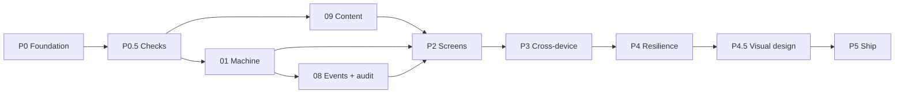

# Plan

The specs say **what** to build; this says **in what order**, what depends on what, how each stage is proven, and what's deliberately left for production. Spec numbers are stable IDs (they're referenced in ACs and commits), not the build order.

## Delivery scope

The specs describe the full design. Anything tagged `production` in a spec is designed and agreed but **not built for the demo**; it's listed in the [production backlog](#production-backlog) below with why it waits and what would trigger it. Untagged requirements and ACs are the demo scope.

## Build order

Each phase ends at a checkpoint. The next phase doesn't start until the checkpoint passes.

| Phase | Work | Specs | Checkpoint |
|---|---|---|---|
| **P0 · Foundation** | Scaffold (Next.js, TS strict, Tailwind, Vitest, ESLint), record versions in constitution §2, `.env.example` + `pnpm bootstrap` | 07 (local part) | `pnpm typecheck && pnpm lint && pnpm test` pass on an empty app; AC-07.2 |
| **P0.5 · Checks** | CI on GitHub Actions (install with frozen lockfile, typecheck, lint, test, build, skill checksums); local git hooks with husky + lint-staged (pre-commit, pre-push) and commitlint (commit-msg) | 07 | AC-07.9 – AC-07.11: CI green on the branch; a lint error, a bad commit message and a failing test are each rejected locally; editing a vendored skill fails the checksum step |
| **P1 · Core logic, no UI** | Content layer (copy must exist before any screen); journey machine + `progressSteps`; `track()` + audit subscriber on the machine | 09, 01, 08 (events + audit only) | AC-01.1 – AC-01.9, AC-09.2, AC-09.5, AC-09.7 and AC-08.1 – AC-08.2 pass as unit tests (logic tasks test-first); machine checked in the Stately visualiser against the flow map |
| **P2 · Single-device happy path** | `SessionStore` (memory) + sessions/status API; D1, D2 ("this device"); document capture + validation; selfie, liveness, face match; review, submit, processing, complete | 02 (store + sessions, Help, Save & exit, `/privacy`), 03, 04, 05 | AC-07.1: a fresh clone completes the whole journey on one device with `pnpm dev`; AC-09.1 (no hard-coded strings) enforced by `pnpm lint` from here on; AC-08.6 (request logs) |
| **P3 · Cross-device** | Handoff issue/redeem, QR (D3, D3b), heartbeat, desktop status polling (D4), phone handback (M7); Redis adapter | 02 (handoff), 05 (D4, M7) | AC-02.1 – AC-02.7; AC-07.8 (`pnpm dev:phone`: handoff to a real phone over HTTPS); AC-07.4 (the same on a Vercel preview, the real multi-instance environment) |
| **P4 · Resilience** | Offline, timeout warning/expiry, rejection, camera/upload errors, manual review (E9), `?fail=` / `?ttl=` switches | 06, 08 (E9) | Every scenario E1 – E9 can be forced and recovers as specified; switches listed in the README |
| **P4.5 · Visual design** | Tokens and Montserrat, contrast test, raw-colour lint rule, restyled components with all states, layouts matched to the five Figma reference screens | 10 | AC-10.1 – AC-10.6; screenshots at 390 / 768 / 1440 px in the PR |
| **P5 · Ship** | Vercel + Upstash per environment, domain, demo banner + `noindex`; accessibility pass; README TBCs filled | 07 | AC-07.4 – AC-07.6; keyboard-only run of the full journey; README has no _TBC_ left |

## Dependencies



- **In parallel:** 09 and 01 don't depend on each other. Within P2, the document (03) and selfie (04) screens can be built side by side once the machine and content exist.
- **Strictly in order:** checks (P0.5) before any feature code, so every agent-written change from P1 on is gated; nothing with copy before 09; nothing with journey behaviour before 01; cross-device before resilience, because E4/E8 depend on the heartbeat and polling.

## Risks

| Risk | Impact | Mitigation |
|---|---|---|
| Camera APIs behave differently on iOS Safari and need HTTPS | Capture fails on real phones | Test on a real phone early in P3 via the tunnel (`pnpm dev:phone`); upload fallback is always visible (spec 03) |
| Vercel's ~4.5 MB request body limit | Uploads fail in production but not locally | Resize on the device before upload (spec 03), with a test that the output stays under the limit; the Vercel preview enforces the real limit |
| State that works only because of shared memory | Passes locally, breaks on Vercel's multiple instances | All session state through `SessionStore` (constitution §7); full handoff on a Vercel preview at the P3 checkpoint, not at the end. The deterministic 2-instance proof is PB-3 |
| Polling lag makes desktop and phone disagree | Confusing status on D4 | Both read `session.step` from the server (R-01.7, R-02.6); 2–3 s interval |
| Time overrun before handover | Incomplete core journey | Over-built scope is already moved to the production backlog; within the demo, Help and Save & exit are simplified first; P0 – P4 core is not cut |

## Task format

Every task in a spec uses this shape, so it can be picked up in one focused session:

```
- [ ] T-NN.n What to do → AC-NN.x · verify: <command or manual check> · files: <paths, ≤ 5> · gate: tests reviewed
```

`gate: tests reviewed` applies to logic tasks only (constitution §8): the failing tests are written and approved before the code. Tasks tagged `production` are not built.

Spec 01 is converted as the reference; the others are converted when they're picked up in this order.

## Production backlog

Designed in the specs, not built for the demo. Effort: S < half a day, M ≈ 1–2 days, L > 2 days.

| # | Item | Spec / IDs | Why it waits | Trigger | Effort |
|---|---|---|---|---|---|
| PB-1 | CMS content source, content API route, runtime validation + fallback, publish revalidation | 09 · R-09.3, R-09.4, R-09.9, AC-09.3, AC-09.4 | One locale; copy changes rarely in a demo | Copy changed by someone outside engineering | M |
| PB-2 | Second locale | 09 · R-09.8, AC-09.6 | One language today | A second language is planned | S |
| PB-3 | Docker `dev` / `prodlike` / `phone` profiles: deterministic 2-instance proof and body-limit proxy | 07 · R-07.3, R-07.4, AC-07.3; 02 · AC-02.8 | A Vercel preview covers it for the demo | Before the first production release; CI | S–M |
| PB-4 | Model-based machine tests (`createTestModel`) | 01 · T-01.7 | Hand-written transition tests cover the ACs | The machine grows beyond the brief | S |
| PB-5 | Resume after Save & exit | 02 · R-02.15, AC-02.15 | The demo shows a saved page only | Abandonment data shows players returning | M |
| PB-6 | Help as a bottom sheet on the phone | 02 · R-02.14 | One responsive dialog works on both | Usability testing on phones | S |
| PB-7 | Offline upload queue that resumes on reconnect | 06 · R-06.7, AC-06.2 | Banner + "Try again" covers the scenario | Poor-connectivity regions in the player base | M |
| PB-8 | Refuse to start with `DEMO_MODE=false` on the mock API | 07 · R-07.8, AC-07.7 | The banner is always on in the demo | A real verification provider is integrated | S |
| PB-9 | Funnel counters, `/insights` page, events to a BI pipeline | 08 · R-08.4, AC-08.5 | Events are in the logs | BI or marketing asks for funnel reporting | M |
| PB-10 | `?step=` in the URL for refresh and back | 01 · design note | Not needed for a short guided journey | Support tickets about refresh / back | S |
| PB-11 | Real verification provider behind the same API (OCR, liveness, face match) | 03, 04 · API sections | Mocked by design in the brief | Go-live | L |
| PB-12 | Signed handoff tokens, rate limiting (per IP and per session), device binding between QR issue and redemption | 02 | The demo threat model is low | Go-live | M |
| PB-13 | Encryption at rest, retention policy, durable access-controlled audit storage for the FICA retention period | 08 · R-08.2; constitution §5 | The demo keeps nothing beyond the session | Go-live | M |
| PB-14 | Error tracking, tracing, alerts and SLOs (time to verify, BR-3; failure-rate spikes), real-user Web Vitals | 08 | Request logs cover the demo | Go-live | M |
| PB-15 | Dark theme and a client brand theme as token sets | 10 · R-10.8, T-10.6 | One neutral theme is enough for the demo | Brand guidelines from the client | S |
